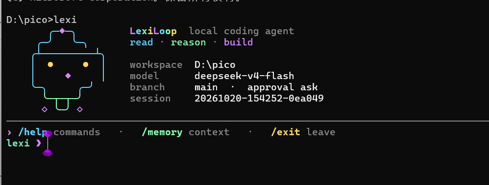
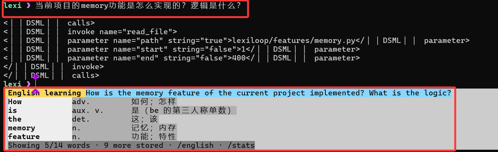

# LexiLoop Harness

`LexiLoop` 是一个运行在终端里的本地 coding agent，项目完整名称为 `LexiLoop-Harness`。它会理解当前代码仓库，通过受约束的工具完成读取、修改和验证，并把会话、运行轨迹与恢复状态保存在本地 `.lexiloop/` 目录中；同时异步翻译用户的真实任务，把译文中的单词、词性、释义和出现次数积累为技术英语学习记录。

它更像一个能在仓库里持续工作的命令行助手，不是纯聊天窗口。你可以拿它做代码排查、测试修复、仓库分析，或者让它在当前项目里执行一次性的工程任务。

## 终端效果

### 启动界面

运行 `lexi` 后，会显示当前工作区、模型、Git 分支、审批模式和会话信息。



### 提示词翻译与英语学习

用户提示词会照常进入 Agent Loop，同时由独立的异步 sidecar 翻译成英文。终端底部展示完整译文和前五个单词的词性、中文释义；未展示的单词也会写入 SQLite，用于累计词频统计。



## 适合做什么

- 在本地仓库里排查测试失败
- 读取当前代码结构并给出修改建议
- 基于现有文件做小步迭代，而不是脱离仓库空想
- 在会话中保留上下文，支持继续上一次工作

## 主要特性

- 产品名是 `LexiLoop`
- Python 包名是 `lexiloop`
- CLI 命令是 `lexi`
- 模块入口是 `python -m lexiloop`
- 异步翻译用户提示词，在终端底部展示译文和前五个单词
- 使用 SQLite 保存所有单词出现记录，并提供词频统计
- 会话保存在 `.lexiloop/sessions/`
- 每次运行的工件保存在 `.lexiloop/runs/<run_id>/`
- 支持四类模型后端：
  - Ollama
  - OpenAI 兼容 Responses API
  - Anthropic 兼容 Messages API
  - DeepSeek Anthropic 兼容 API

## 安装

需要 Python 3.10+。

如果你用 `uv`，直接安装依赖：

```bash
uv sync
```

如果你已经在自己的 Python 环境里工作，也可以直接装成可编辑模式：

```bash
pip install -e .
```

## 快速开始

在当前仓库里启动交互模式。默认 provider 是 DeepSeek：

```bash
uv run lexi
```

指定另一个工作目录：

```bash
uv run lexi --cwd /path/to/repo
```

直接跑一次性任务：

```bash
uv run lexi "inspect the test failures and propose a fix"
```

如果当前环境已经安装过包，也可以直接这样启动：

```bash
python -m lexiloop
```

## 模型后端

LexiLoop 启动时会读取项目根目录的 `.env`。本地真实 key 放在 `.env`，仓库只保留 `.env.example`。配置优先级是：

```text
显式 CLI 参数 > .env 里的 LEXILOOP_* 变量 > 旧环境变量 > 代码默认值
```

Provider 选择的具体顺序是：

```text
--provider > LEXILOOP_PROVIDER > 代码默认 deepseek
```

不传 `--provider` 且没有 `LEXILOOP_PROVIDER` 时默认使用 `deepseek`。这是推荐配置路径：DeepSeek 的 Anthropic-compatible endpoint 比本地 Ollama 更少依赖本机模型环境，也比 OpenAI-compatible/Anthropic-compatible 代理少一层默认 gateway 假设。其他 provider 仍然保留，可以在 `.env` 里写 `LEXILOOP_PROVIDER=openai`、`LEXILOOP_PROVIDER=anthropic`、`LEXILOOP_PROVIDER=ollama`，也可以显式传 `--provider openai`、`--provider anthropic` 或 `--provider ollama`。

`.env` 会在构建 provider client 前加载，并覆盖当前进程里的同名环境变量。模型名和 base URL 可以通过 `--model`、`--base-url` 临时覆盖；API key 只从环境变量读取。

本地第一次配置：

```bash
cp .env.example .env
```

然后把要使用的 provider key 填进去。`.env` 已经被 `.gitignore` 忽略，不要提交真实 key。

### 推荐配置：DeepSeek

最小配置只需要 key：

```bash
LEXILOOP_DEEPSEEK_API_KEY="your-api-key"
```

默认模型和接口是：

```bash
LEXILOOP_DEEPSEEK_API_BASE="https://api.deepseek.com/anthropic"
LEXILOOP_DEEPSEEK_MODEL="deepseek-v4-pro"
```

所以常规情况下 `.env` 里只填 `LEXILOOP_DEEPSEEK_API_KEY` 就能直接启动：

```bash
uv run lexi
```

如果你需要临时切模型或代理地址，不必改 `.env`，可以直接覆盖：

```bash
uv run lexi --model deepseek-v4-pro --base-url https://api.deepseek.com/anthropic
```

DeepSeek 当前走 Anthropic-compatible Messages API，所以 runtime 里复用的是 Anthropic-compatible client；这只影响 HTTP 协议，不影响 CLI 用法。

LexiLoop 当前使用文本编码的工具协议，因此会在 DeepSeek 请求中显式关闭 provider-native thinking，避免思考内容耗尽单步输出预算或产生无法回放的 thinking block。后续如果接入原生工具协议，需要同时实现 thinking block 的完整回放，不能只删除这个开关。

### 可选配置：right.codes

right.codes 在 LexiLoop 里有两条可选 provider 路径：

- `--provider openai`：走 OpenAI-compatible `/responses`，默认 base URL 是 `https://www.right.codes/codex/v1`，默认模型是 `gpt-5.4`
- `--provider anthropic`：走 Anthropic-compatible `/messages`，默认 base URL 是 `https://www.right.codes/claude/v1`，默认模型是 `claude-sonnet-4-6`

如果 right.codes 给你的是一把共享 key，推荐只填这一项：

```bash
LEXILOOP_RIGHT_CODES_API_KEY="your-right-codes-key"
```

然后按需要选择 provider：

```bash
uv run lexi --provider openai
uv run lexi --provider anthropic
```

如果你想显式区分两条 provider 的 key，也可以分别配置：

```bash
LEXILOOP_OPENAI_API_KEY="your-right-codes-key-for-codex"
LEXILOOP_ANTHROPIC_API_KEY="your-right-codes-key-for-claude"
```

不要在 `.env` 里写 `LEXILOOP_OPENAI_API_KEY=$LEXILOOP_RIGHT_CODES_API_KEY` 这种 shell 展开形式；LexiLoop 的 `.env` 解析器只读取字面量，不展开变量引用。要么只写 `LEXILOOP_RIGHT_CODES_API_KEY`，要么把 key 字符串分别填到 provider-specific 变量里。

如果请求 right.codes 返回 `API Key额度不足`，说明协议和 endpoint 已经打通，但当前 key 没有可用额度；换一把有额度的 key，或到 right.codes 后台处理额度。

当前 provider 环境变量：

| provider | base URL | API key | model |
| --- | --- | --- | --- |
| `deepseek` | `LEXILOOP_DEEPSEEK_API_BASE`，回退 `DEEPSEEK_API_BASE`，默认 `https://api.deepseek.com/anthropic` | `LEXILOOP_DEEPSEEK_API_KEY`，回退 `DEEPSEEK_API_KEY` | `LEXILOOP_DEEPSEEK_MODEL`，回退 `DEEPSEEK_MODEL`，默认 `deepseek-v4-pro` |
| `openai` | `LEXILOOP_OPENAI_API_BASE`，回退 `OPENAI_API_BASE`，默认 `https://www.right.codes/codex/v1` | `LEXILOOP_OPENAI_API_KEY`，回退 `OPENAI_API_KEY`、`LEXILOOP_RIGHT_CODES_API_KEY`、`RIGHT_CODES_API_KEY`、`LEXILOOP_ANTHROPIC_API_KEY`、`ANTHROPIC_API_KEY` | `LEXILOOP_OPENAI_MODEL`，回退 `OPENAI_MODEL`，默认 `gpt-5.4` |
| `anthropic` | `LEXILOOP_ANTHROPIC_API_BASE`，回退 `ANTHROPIC_API_BASE`，默认 `https://www.right.codes/claude/v1` | `LEXILOOP_ANTHROPIC_API_KEY`，回退 `ANTHROPIC_API_KEY`、`LEXILOOP_RIGHT_CODES_API_KEY`、`RIGHT_CODES_API_KEY`、`LEXILOOP_OPENAI_API_KEY`、`OPENAI_API_KEY` | `LEXILOOP_ANTHROPIC_MODEL`，回退 `ANTHROPIC_MODEL`，默认 `claude-sonnet-4-6` |
| `ollama` | `--host`，默认 `http://127.0.0.1:11434` | 不需要 | `--model`，默认 `qwen3.5:4b` |

如果有额外的敏感环境变量需要从 trace/report 里脱敏，可以用 `LEXILOOP_SECRET_ENV_NAMES` 配置逗号分隔的变量名，或启动时重复传 `--secret-env-name NAME`。

### OpenAI 兼容接口

如果要改用 OpenAI-compatible `/responses` 服务，显式传 `--provider openai`：

```bash
uv run lexi --provider openai
```

默认 OpenAI 兼容接口使用 right.codes 的 Codex endpoint：

```bash
LEXILOOP_OPENAI_API_BASE="https://www.right.codes/codex/v1"
LEXILOOP_RIGHT_CODES_API_KEY="your-right-codes-key"
LEXILOOP_OPENAI_MODEL="gpt-5.4"
```

也可以改成其他 OpenAI-compatible 服务：

```bash
LEXILOOP_OPENAI_API_BASE="https://your-api.example/v1"
LEXILOOP_OPENAI_API_KEY="your-api-key"
LEXILOOP_OPENAI_MODEL="gpt-5.4"
```

### Anthropic 兼容接口

如果要改用 Anthropic-compatible 服务，显式传 `--provider anthropic`：

```bash
uv run lexi --provider anthropic
```

默认 Anthropic 兼容接口使用 right.codes 的 Claude endpoint：

```bash
LEXILOOP_ANTHROPIC_API_BASE="https://www.right.codes/claude/v1"
LEXILOOP_RIGHT_CODES_API_KEY="your-right-codes-key"
LEXILOOP_ANTHROPIC_MODEL="claude-sonnet-4-6"
```

如果你的服务端对多个兼容接口复用了同一套密钥，`LexiLoop` 也支持从 `LEXILOOP_ANTHROPIC_API_KEY` 回退到 `ANTHROPIC_API_KEY`、`LEXILOOP_RIGHT_CODES_API_KEY`、`RIGHT_CODES_API_KEY`、`LEXILOOP_OPENAI_API_KEY` 或 `OPENAI_API_KEY`。

### Ollama

如果要改用本地 Ollama，显式传 `--provider ollama`：

```bash
ollama serve
ollama pull qwen3.5:4b
uv run lexi --provider ollama --model qwen3.5:4b
```

## 常用交互命令

- `/help`：查看内置命令
- `/memory`：查看提炼后的工作记忆
- `/session`：查看当前会话文件路径
- `/english`：查看最近一次英文翻译和前五个单词
- `/word`：`/english` 的兼容别名
- `/stats`：查看提示词翻译数量、单词总数和高频词
- `/reset`：清空当前会话状态
- `/exit` 或 `/quit`：退出 REPL

## 技术英语学习

用户提交普通提示词时，LexiLoop 会同时启动两条互不阻塞的链路：原始提示词立即进入 Agent Loop；独立的学习 sidecar 使用另一个模型客户端在后台翻译提示词并标注词性和中文释义。翻译完成后，终端输入区底部会显示完整译文和前五个单词，其余单词虽然不展示，但同样会入库。

学习数据保存在用户级的 `~/.lexiloop/learning/vocabulary.db`，因此切换代码仓库后仍会沿用同一份进度。数据库会保存翻译批次和每一个单词出现记录，包括 `and`、`or`、`you` 等常用词和重复出现的词；原始中文提示词和完整英文译文都不会写入数据库。

可以用 `lexi --no-learning` 临时关闭，或设置 `LEXILOOP_LEARNING=0` 长期关闭。翻译、解析或数据库写入失败都不会中断 Agent Loop；若终端不支持增强输入界面，程序也会自动退回普通输入模式。

## 安全与持久化

`LexiLoop` 不会默认把所有动作都放开。像 shell 执行、文件写入这类高风险操作，会受审批模式控制：

- `--approval ask`
- `--approval auto`
- `--approval never`

每次运行结束后，都会在 `.lexiloop/runs/<run_id>/` 下写出这些文件：

- `task_state.json`
- `trace.jsonl`
- `report.json`

这些内容默认只保存在本地，不需要跟仓库一起提交。

## 开发

常用本地检查：

```bash
uv run pytest tests -q
uv run ruff check lexiloop tests scripts
```

内部代码现在按较轻的边界拆分：`lexiloop/evaluation/` 放 benchmark 和 metrics，`lexiloop/providers/` 放模型 provider client，`lexiloop/features/` 放可选运行时能力。新代码应直接使用这些包路径；旧的 `lexiloop.evaluator`、`lexiloop.metrics`、`lexiloop.models` 和 `lexiloop.memory` import 不再作为公共入口保留。
